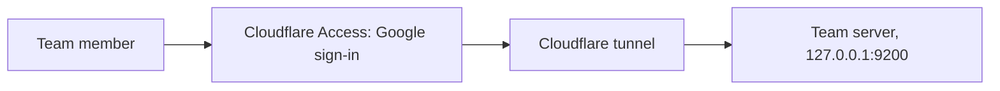

# Team access for Pages: setup guide

This guide connects the team link to Google sign-in. It covers step 9 of the build plan. The code is on the branch `feat/pages-team-access`.

| | |
|---|---|
| Time | About 50 minutes: 30 for Cloudflare, 20 for Google |
| Who | Kian, with a Google Workspace administrator for part B |
| Result | `https://pages.getincredible.com` opens the Google sign-in, then the pages that are shared with the person |

## What the setup builds



- **Cloudflare Access** shows the Google sign-in. Only `@getincredible.com` accounts pass.
- **The tunnel** carries the traffic to this server. The server opens no port to the internet.
- **The team server** checks the sign-in proof from Cloudflare on every request. It checks the domain again, and it checks the role for each page.

## Facts about this server

- The DNS for `getincredible.com` is on Cloudflare (name servers `micah` and `romina` at `ns.cloudflare.com`). The web address `pages.getincredible.com` can use the same Cloudflare account.
- `cloudflared` version 2026.7.3 is installed at `/usr/local/bin/cloudflared`. No tunnel runs on this server now.
- User services continue after log-out (`Linger=yes`).

## Part A: Cloudflare (Kian, 30 minutes)

You need access to the Cloudflare account that holds `getincredible.com`.

1. Open [one.dash.cloudflare.com](https://one.dash.cloudflare.com) and select the account.
2. If Zero Trust asks for a team name, type `incredible`. Select the Free plan. Your team domain is then `incredible.cloudflareaccess.com`. If the team name exists already, write down the team domain that the dashboard shows.
3. Do part B now. Then come back to step 4.
4. Go to **Settings > Authentication > Login methods > Add new > Google Workspace**. Paste the client ID and the client secret from part B. Type `getincredible.com` as the domain. Select **Test**. The test must show your account.
5. Go to **Access > Applications > Add an application > Self-hosted**.
   - Application name: `Pages team access`
   - Session duration: `24 hours`
   - Public hostname: subdomain `pages`, domain `getincredible.com`
   - Login methods: select only **Google Workspace**. Turn on **Instant Auth**.
6. Add a policy to the application.
   - Policy name: `Incredible accounts`
   - Action: **Allow**
   - Include: **Emails ending in** `@getincredible.com`
7. Save the application. Open it again, and copy the **Application Audience (AUD) Tag**. You need it in part C.
8. Go to **Networks > Tunnels > Create a tunnel > Cloudflared**. Name it `pages-team`.
9. The dashboard shows an install command with a long token after `--token`. Copy only the token. Do not run the install command. `cloudflared` is installed already.
10. On the **Public hostname** tab of the tunnel, add one hostname.
    - Subdomain `pages`, domain `getincredible.com`
    - Service type `HTTP`, URL `127.0.0.1:9200`

    The URL must be `127.0.0.1:9200`. Never use `9201` or `9100`. Port 9201 is the Owner's entry, and port 9100 is the Craft Agents app.

## Part B: Google sign-in connection (Google Workspace administrator, 20 minutes)

1. Open [console.cloud.google.com](https://console.cloud.google.com) with an `@getincredible.com` administrator account.
2. Create a project named `Pages team access`, or select an existing internal project.
3. Go to **APIs & Services > OAuth consent screen**. Select **Internal**. Type the app name `Incredible pages` and a support email. Save.
4. Go to **APIs & Services > Credentials > Create credentials > OAuth client ID**.
   - Application type: **Web application**
   - Authorized JavaScript origins: `https://incredible.cloudflareaccess.com`
   - Authorized redirect URIs: `https://incredible.cloudflareaccess.com/cdn-cgi/access/callback`

   If your team domain in part A step 2 is different, use that domain in both fields.
5. Copy the client ID and the client secret. Give them to Kian for part A step 4.

The **Internal** setting stops accounts outside `getincredible.com` at Google. Cloudflare and the team server check the domain again.

## Part C: start the services (Kian, 10 minutes)

Run these commands on the server. Replace the values in capitals.

Until the branch is merged (step 10 of the build plan), the code is in the worktree `~/craft-agents-pages-team`. After the merge, it is in `~/craft-agents-oss`. The commands use `REPO` for this folder.

1. Set the folder, and save the tunnel token. The token file must have mode 600.

   ```bash
   REPO=~/craft-agents-pages-team
   install -m 600 /dev/null ~/.config/craft-agents/cloudflared-pages.token
   printf '%s' 'PASTE_TUNNEL_TOKEN' > ~/.config/craft-agents/cloudflared-pages.token
   ```

2. Create the settings file from the example, and set the AUD tag.

   ```bash
   install -m 600 $REPO/packages/pages-team/deploy/pages-team.env.example ~/.config/craft-agents/pages-team.env
   sed -i 's/^PAGES_TEAM_ACCESS_AUD=.*/PAGES_TEAM_ACCESS_AUD=PASTE_AUD_TAG/' ~/.config/craft-agents/pages-team.env
   ```

   If your team domain is not `incredible.cloudflareaccess.com`, change `PAGES_TEAM_ACCESS_TEAM_DOMAIN` in the same file.

3. Install and start the two services. The `sed` command points the service at `REPO`.

   ```bash
   cp $REPO/packages/pages-team/deploy/pages-team.service $REPO/packages/pages-team/deploy/cloudflared-pages.service ~/.config/systemd/user/
   sed -i "s#^WorkingDirectory=.*#WorkingDirectory=$REPO/packages/pages-team#" ~/.config/systemd/user/pages-team.service
   systemctl --user daemon-reload
   systemctl --user enable --now pages-team cloudflared-pages
   ```

   The start of the team server needs no restart of the Craft Agents server. After the merge, run the `sed` and `daemon-reload` commands again with `REPO=~/craft-agents-oss`, then `systemctl --user restart pages-team`.

4. Check the result.

   ```bash
   tail -n 5 ~/.local/state/craft-agents/pages-team.log
   curl -s -o /dev/null -w '%{http_code}\n' http://127.0.0.1:9200/api/pages
   ```

   The log must show `sign-in: Cloudflare Access (incredible.cloudflareaccess.com)`. The `curl` command must print `401`, because a request without a Cloudflare sign-in proof gets no access.

5. Open `https://pages.getincredible.com` in a browser. Sign in with your Google account. The page "Pages shared with you" lists each page, because you are the Owner.

## Part D: the first real test (Kian and a second person, 10 minutes)

1. In the app, open a page, open **Share**, and add the second person as **Commenter** in the Team section. This needs the app restart of step 10. Before step 10, add the person from the team link: open the page at `https://pages.getincredible.com/p/SLUG`, select **People**, and add the email.
2. The second person opens the team link and signs in.
3. The second person writes a comment. On your team link, the comment shows in the comment panel within 20 seconds.
4. Change the role of the second person to **Viewer**. Within 1 minute, the comment box disappears for that person.
5. Remove the second person. Within 1 minute, the page shows "You do not have access to this page. Ask the owner for access."

## Stop and roll back

- Stop the team link at once: `systemctl --user stop cloudflared-pages`. The team server can continue to run. Nothing reaches it from the internet.
- Stop both: `systemctl --user disable --now cloudflared-pages pages-team`.
- The team store stays in `pages/{slug}/team/` in the workspace. Deleting it deletes the people, the roles, and the comments of that page.
- To remove the Cloudflare side, delete the tunnel `pages-team` and the application `Pages team access` in the Zero Trust dashboard.

## Settings reference

| Setting | Meaning |
|---|---|
| `PAGES_TEAM_WORKSPACE_ROOT` | The workspace whose pages the team link serves |
| `PAGES_TEAM_OWNER_EMAIL` | The Owner. Always the Owner on the team link. |
| `PAGES_TEAM_ALLOWED_DOMAIN` | Only accounts at this domain get a role. Default `getincredible.com`. |
| `PAGES_TEAM_PUBLIC_URL` | The team link address. The app shows links with it. |
| `PAGES_TEAM_ACCESS_TEAM_DOMAIN` | The Zero Trust team domain |
| `PAGES_TEAM_ACCESS_AUD` | The AUD tag of the Access application |
| `PAGES_TEAM_OWNER_SECRET_FILE` | The owner secret. The team server creates it with mode 600 on the first start. The app and the agent read it. |
| `PAGES_TEAM_DEV_IDENTITY` | Local tests only. The server refuses to start if this is set together with the Cloudflare settings. |
